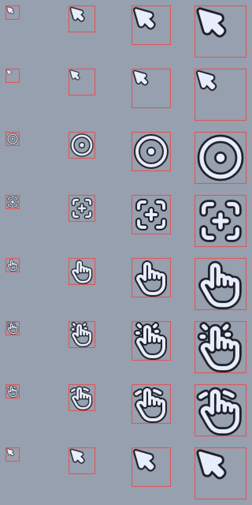

Thanks for the re-review. Pushed `8ac4e612f` (merge of `main`), `912cf4625` (outline fix) and `6fdc9869e` (TASKS line).

### 1. Arrow outline
- `draw_arrow` keeps `stroke-width="3.2"` and lets the transform scale it, so the outline is about `2 × scale` px.
- With the right width the outline still reached the top-left corner (it was cut at every size, not only at 64 px), so the arrow now moves up and left by `0.4 × scale` instead of `1.2 × scale`. The hotspot follows the ink's tip (`round(1.4 × scale)`), which stays `[1, 1]` for the badge cursors.
- `pointer_preferences_resize_the_pointer_and_keep_each_look_hotspot_visible` now checks that the top row and left column of the 64 px compact and Theme arrows are transparent, and `touch_cursor_preferences_resize_and_change_the_hover_hand` does the same for the 64 px "Normal mouse pointer" touch look. Both fail on `8238dfa32`.
- New looks capture (the cursor bitmaps at 16, 32, 48 and 64 px, a red frame around each bitmap; rows: Theme arrow, compact arrow, ring, crosshair, then the touch looks pointing, clicking, moving and the theme arrow):

### 2. Rebase
Merged the current `main`; the only conflict was `TASKS.md`, where I kept main's lines and this PR's single line.

### 3. Human validation
Checked by eye in the demo (`AURORA_DEMO_OPTIONS=accessibility:search=cursor`) on 2026-11-26: every pointer and touch look at 16, 32 and 64 px, the arrow outline in proportion with no cut corner, and the Pointer size row greyed with System selected, on the page and in the search view. The TASKS.md line now says so with the date.

The smaller points are left for a follow-up unless you want them in this PR.

Could you approve the CI runs of `6fdc9869e`?
