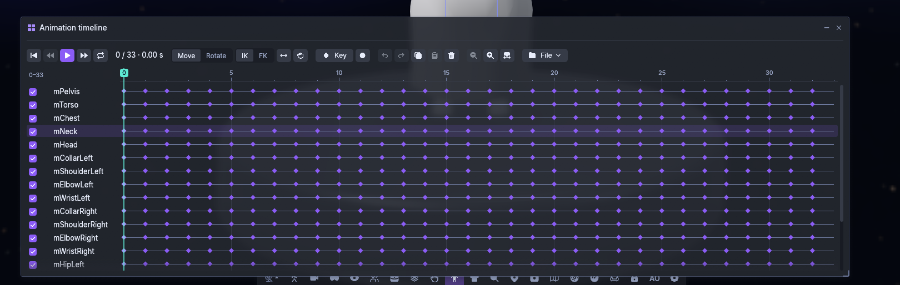
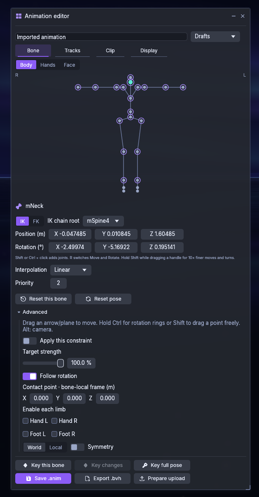
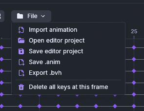
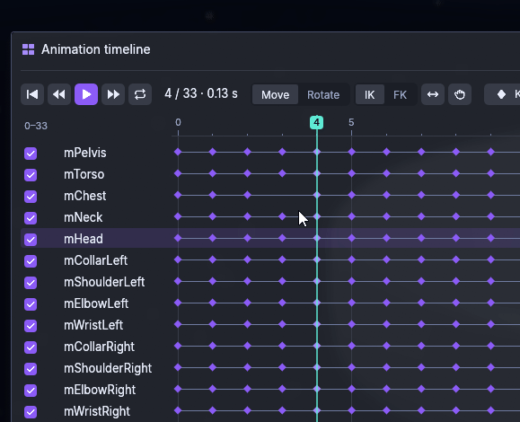
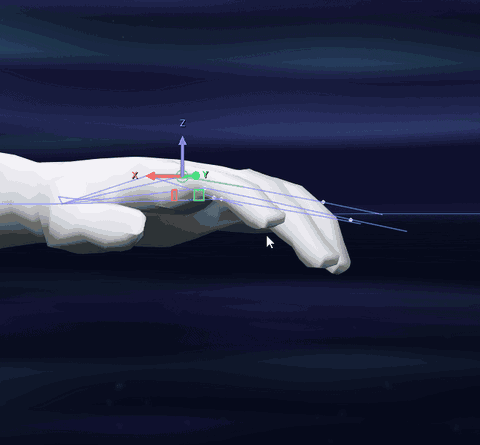

No issue

Follows #2739.

## What it is for

Creators can now take an animation made in Avatar Studio back to Blender (or any other BVH tool): **Export .bvh** writes the clip on the avatar's skeleton, next to the existing Save .anim. The timeline can also pick several keys at once, so they can be moved, copied or deleted together instead of one by one, and the animation editor gains several quality-of-life fixes from a day of hands-on testing: several joints edited together, finer handle drags, a steady camera, an R key to switch Move and Rotate, and a cleaner panel.

It also adds a **couple mode**: two people animated in one timeline, for couple poses and dances. Second Life plays one animation per avatar, so each person keeps their own clip, and Save or Export writes both files plus a note of where the second person stands from the first, for the furniture's sit targets.

## Legacy Viewer origin

No for the editor features (the Legacy Viewer has no animation editor). The BVH writer is the inverse of the existing import, which follows `LLBVHLoader::loadBVHFile` / `makeTranslation` (indra/llcharacter/llbvhloader.cpp): same Y-up inches to Z-up metres basis, frame 0 as the rest reference the pelvis is measured from, Zrotation Xrotation Yrotation channel order.

## What changes

- **Export:** `aurora_assets::import_animation::encode_bvh` writes every bone of the rest skeleton (no collision volumes) with its rest OFFSETs, a rest reference frame, then one frame per `1 / fps` up to the clip's duration. The pelvis carries position channels over its rest offset (the hips keep their height in Blender), and so does any bone the clip moves. Angles are filtered from frame to frame (each within half a turn of the last, and the other Euler set of the same rotation when it is closer), so a tool that interpolates between frames never spins a bone the long way round.
- **Interface, editor panel:** a new **Export .bvh** button between Save .anim and Prepare upload; it follows the same "loop to last key" range as Save .anim. Its tooltip says what a BVH cannot hold (priorities, loop, ease, hand pose).
- **Interface, timeline:** keys can be picked several at a time. A click picks one key, Ctrl (Cmd) + click toggles it, Shift + click adds it, Shift or Ctrl + drag anywhere over the lanes (on a key, between rows or below them) draws a box that picks the keys inside it, Ctrl+A picks every shown key and Esc drops them. A plain click on an empty spot drops them too; a plain drag on the lanes still scrubs as before. Picked keys are drawn in teal.
- **Editing:** dragging one picked key moves them all by the same number of frames (the playhead stays where it is), with a ghost of each destination while dragging; the move stops at frame 0 and grows the range past the end, and keys moving onto each other's frames do not replace one another. Delete (and the trash button) removes every picked key. With several keys picked, Ctrl+C copies the keys themselves and Ctrl+V pastes them at the playhead with their spacing, and the pasted keys are picked; with one key picked (a plain click), Ctrl+C still copies the frame's pose as before. Each of these is one undo step.
- **Quality of life:** the timeline status line says how many keys are picked and what can be done with them; the timeline File menu also has Save .anim and Export .bvh, so the timeline alone covers the whole loop. Shortcuts keep the existing rule: Ctrl+A, Esc and Delete only take their key when they act.
- **Timeline, after testing:** the box no longer has to start on an empty spot of a lane, and a box started between or under the lanes no longer drags the timeline window. A right-click over the lanes drops the picked keys (it never deletes them).
- **Several joints at once (animation editor):** Shift or Ctrl + click on a joint handle, a bone, a picker dot or a Tracks row adds the joint to the selection; a plain click picks one again. The joints added follow the selected one: a turn turns each of them by the same local rotation, a move moves each by the same offset, and all of them are keyed together (their mirrors too when Symmetry is on). The added joints are ringed in teal, and the Bone page shows how many follow with an "Only this one" button. In the pose editor, Ctrl+click now adds a joint on its marker and shaft as well as on its row (Shift+click already did).
- **Finer handle drags:** holding Shift during a handle drag moves and turns the joint ten times finer, in the pose and the animation editors; pressing or releasing Shift mid-drag rebases the drag so the joint does not jump.
- **Camera and tools:** a press on a joint's handle or bone no longer also turns Avatar Studio's camera. A vertical left drag on the stage tilts the camera up or down, to 80 degrees at most and never under the stage floor, where the stage's water fog would hide the avatar; Reset returns to the default view. **R** switches the gizmo between Move and Rotate; the tool stays from joint to joint, and Shift no longer turns Rotate into Move in the animation editor.
- **Steady fields:** an edited joint's position and rotation fields no longer flicker while nothing changes (they were re-read from the shown pose every frame).
- **Animation editor panel:** the Bone page gets the interface's section header and icon buttons (Reset this bone, Reset pose) and a short hint line for the shortcuts; the footer's key, save, export and upload buttons all carry a filled Tabler icon the viewer embeds and share one width. The Drafts menu lists every draft at a fixed place with the open one ticked, instead of reshuffling on each switch. The bone picker is drawn wider and taller so its dots are easier to hit.
- **Couple mode (animation editor, Clip page):**
  - Person B is a nearby resident who accepts the same consent as the Poser: the Clip page lists them with Ask, then Use as B. Only the user sees the pose.
  - The editor works on one person at a time, with all its tools. The person set aside shows their own keys at the shared playhead, plus their edits not keyed yet. Each person has their own undo, and B starts from their rest pose with A's range, rate and settings.
  - The timeline lists A's lanes, then B's, under each name ("Person B", the resident's name stays on the Clip page): A in violet, B in amber. A click on the other person's name or lanes edits them, and so does a click on one of their joint dots, with that joint picked. A drag over any timeline row moves the playhead.
  - Person B can be moved on screen only (forward, left, up and turn in A's facing; Face to face; Reset), never in their animation, and stays where they stood when they became B even if they walk in-world. Avatar Studio's Hover lifts both people.
  - Save and Export .bvh write `<name> A`, `<name> B` and `<name> placement.txt` (B's position and turn in A's avatar space). Upload stays the edited person's own.
  - A partner who teleports away or logs off stays drawn, standing still, until couple mode ends; a withdrawn consent ends couple mode, and B's animation stays among the drafts.
  - The Ask list says why a request may not arrive: the partner must wear the bridge, stand in the region and allow the user in their posing privacy (Friends by default).
  - Demo: `AURORA_DEMO_COUPLE=1` (a demo resident stands beside you and accepts), `=leave` (she teleports away 10 s after becoming Person B).
- **Fix found while testing couple mode on the grid:** a clip that keys no pelvis position (an imported .anim without hip motion) put the hips on the avatar's shaped rest pelvis, which a worn mesh's pelvis override can place metres up: the editing avatar rose about 10 m while such a clip played. It now stands where a zero pelvis key would, like a clip that keys the hips.
- **Translations:** new and changed keys in English, French and Japanese.
- **Second review (2026-11-16), after merging main:**
  - A 60 s clip exported as .bvh at 24, 36 or 60 fps imports back again: the frame time was rounded to six decimals, which made the file read as just over the 60 s the import (like `LLBVHLoader`) accepts. It is now floored, and the frames are sampled at that same step.
  - A group drag that cannot move (a picked key already at frame 0, dragged left) no longer adds an empty undo step nor clears the redo history.
  - A key of a lane the timeline no longer shows (a joint's hidden rest key picked with Ctrl+A while that joint was selected) leaves the pick, so a later group move cannot author a joint the user never keyed.
  - A press on a limb pole handle no longer also turns Avatar Studio's camera, and in the animation editor a pole click drops the joints picked with another one instead of making them follow that limb.
  - Every other way of selecting a joint in the animation editor (the joint list, a pole, a binding, a link) now follows the same rule as a click or the timeline: a joint of the selection leads the others, any other joint is selected alone. Before, the joints picked earlier kept following the new one.
  - Turning a joint with its parent picked too (a wrist with its elbow) no longer shakes: the parent's turn carried the joint off the handle, the next frame turned it back, and the parent with it. The joint is now solved again under its turned parent, so it holds the handle's rotation and the parent turns smoothly with it.
  - With keys a few frames apart, a click on a lane snapped the playhead to the nearest key, so it could not reach the frames between them. A key is now taken only on its diamond (or its own frame) when frames are packed; zoomed in, the reach is unchanged.
  - Avatar Studio's first **Animate** press opens the animation editor again. Since #3845 records edits from the session base, a new animation was refused while no edit session had run yet, so the first press left the editor half open and only the second worked. With no edit yet there is nothing to tell from the base, so the new animation starts from the rest skeleton as before; edits without their base are still refused.
  - Joints moved together each get their move: one that an earlier follower's chain swung (a wrist picked with its elbow) was skipped.

## Screenshots

Demo mode, 2026-11-14.

Animation timeline with the whole clip keyed:

Animation editor: Bone page, wider bone picker, icon buttons of equal width:

Timeline File menu with Save .anim and Export .bvh:

Picking keys on the timeline:

Fine handle drag (Shift) on a hand joint:

## Tests

- [x] New unit tests: a BVH exported from a clip imports back (`parse_bvh_for_edit`) to the same rotations and pelvis positions; its hierarchy is the rest skeleton without collision volumes, with a rest frame 0; an unknown joint is refused; angles never jump a full turn between frames. Group moves keep spacing, stop at frame 0, grow the range and do not replace each other; deleting picked keys keeps a draft's hidden rest keys; pick rules (click, Ctrl, Shift, drag); box hit-testing; an egui test that drags one of two picked keys and checks both move in one undo step; an egui test where Shift + drag from a key boxes keys without moving it; copy and paste of picked keys keep their spacing and values; Delete, Ctrl+A and Esc through the shortcut handler.
- [x] `cargo fmt --check`, clippy `-D warnings` and `cargo test --workspace` on Linux: the new code is clean and every test passes except the already known `chat_log::import::tests::a_failure_leaves_the_file_as_it_was`, which fails only when the tests run as root.
- [x] `scripts/check.ps1` on Windows (2026-11-14, at f42517ee): formatting, scripts, clippy `-D warnings` and the full workspace tests are green: 9,252 passed, 0 failed, 55 ignored.
- [x] More unit tests for the later rounds: a box dragged from under the lanes does not move the window; a right-click over the lanes drops the picked keys; Ctrl or Shift + click adds a joint in the animation editor and a plain click resets; joints selected together turn with the selected one and are keyed with it; the animation editor keeps its tool and Shift does not turn Rotate into Move; an edited joint's fields hold still while the shown pose only jitters; Shift during a handle drag is ten times finer without a jump, in the pose and animation editors only; the Drafts list shows every draft in its place while switching; the animation editor's buttons only use icons the viewer embeds.
- [x] After the merge with main and the second review (2026-11-16): new unit tests `a_sixty_second_bvh_imports_back_at_every_frame_rate` and `a_group_drag_that_cannot_move_leaves_undo_and_redo_alone`, `every_other_way_of_selecting_a_joint_keeps_the_joints_picked_together_right`, `turning_a_joint_with_its_parent_picked_holds_steady_over_a_drag`, `a_new_animation_with_no_edit_yet_needs_no_base` and packed-key cases in the key hit test; `cargo fmt --check` clean; clippy on Linux reports nothing in the changed code; `cargo test --workspace` on Linux passes except `chat_log::import::tests::a_failure_leaves_the_file_as_it_was` and `transcripts::tests::the_conversation_log_follows_the_conversations`, which fail in the Linux test container in code this PR does not touch (`world/`). The human tested the first six fixes in demo mode on 2026-11-16 and reported the shaking rotate and the playhead snapping; after their fix the human confirmed the rotate holds steady, and validated the whole second review, the playhead and the first Animate press in demo mode on 2026-11-16.
- [x] Couple mode and the pelvis fix (2026-11-16): new unit tests for the person swap (every part of the editing state goes with its person, the switch waits for the preview), the waiting person's sample at the shared playhead, ending couple mode, the placement note, the ruler drag in couple mode, a click on the other person's joint, the "Person B" label, the studio Hover lifting B but not the placement, B held in place while walking, and a clip without a pelvis key standing at the rig's pelvis height. Tested by the human in demo mode (`AURORA_DEMO_COUPLE`) and on the grid with a second account on 2026-11-16: consent, editing both people, moving B, import onto each person; the human confirmed the pelvis fix on the grid.
- [x] Validated by the human in demo mode on 2026-11-14, over five test rounds: a clip exported as .bvh, opened in Blender and imported back, key picking (click, Ctrl, Shift, box, Ctrl+A, Esc, right-click), moving, copying and deleting picked keys, several joints edited together, Shift fine drags, R, the camera staying still, the Drafts menu and the panel's look.

## Limits and follow-up

- A BVH has no place for priorities, loop points, ease, hand pose or expression: they stay in the .anim only.
- A bone keyed at its rest rotation for the whole clip is not distinguishable from an unkeyed one in a BVH, so it does not come back as a track on re-import (its motion is unchanged).
- Couple mode, later (⬜ in TASKS.md): a stand-in partner for animating alone; range, rate and loop changes on one person following on the other; B's click-picking in the world still uses where they really stand, not where they are drawn.
